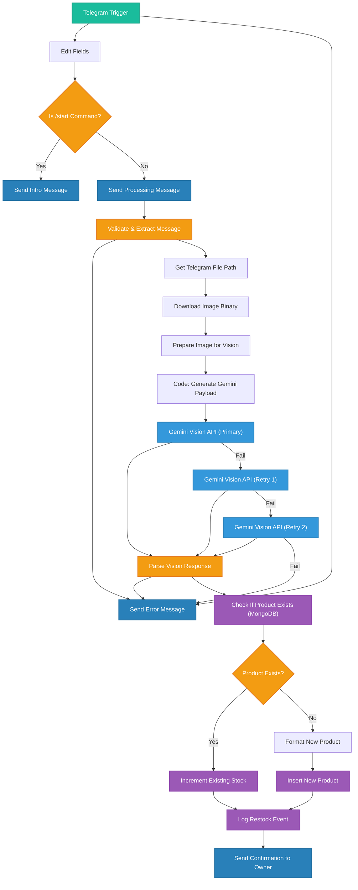

<div align="center">

# StockSense 📦

**Intelligent Retail POS : Automate inventory management with Gemini Vision AI and real-time syncing.**

[Overview](#-overview--screenshots) • [Architecture](#%EF%B8%8F-project-structure) • [n8n Workflow](#-n8n-automated-vision-workflow) • [Quick Start](#-quick-start-guide)


</div>

<br/>

StockSense is an intelligent, automated inventory management and POS system built to simplify Kirana store (retail) operations. It seamlessly blends a **FastAPI/MongoDB Backend**, a **React Frontend**, and an **n8n Automated Workflow** equipped with **Gemini Vision AI** to let you instantly restock your shelves by simply taking a picture of the product.

## 📸 Overview & Screenshots

### POS Billing Dashboard
A high-performance Point of Sale (POS) counter built with React. Add products to your bill, manage stock dynamically, and check out with real-time sync to MongoDB.


### Live Inventory Management
View your products, monitor real-time stock levels, sort, and manage low-stock thresholds. Fully hooked up to the backend.


### Telegram Vision AI Restocking
Simply send an image of a product with its quantity to the Telegram bot. StockSense's n8n workflow uses Gemini Vision API to instantly recognize the product and add it directly to your inventory database.


### Real-Time Restock Alerts
Whenever a checkout causes a product's stock to drop below its minimum threshold, the FastAPI backend instantly triggers an n8n webhook to alert you!


---

## 🛠️ Project Structure

The project is split into three main components:

- `/client` - **React Frontend** 
  - Developed using Vite and React.
  - Contains `App.tsx` (main router/state), `BillingCounter.tsx` (POS interface), and `InventoryStatus.tsx` (Dashboard).
  - Continuously polls the backend for live inventory status.

- `/server` - **FastAPI Backend**
  - Powered by Python, FastAPI, and `uv` package manager.
  - Asynchronous Motor MongoDB connection (`database.py`).
  - Strict data validation using Pydantic (`models.py`).
  - Endpoints to process checkouts (`routes/checkout.py`), handle inventory (`routes/inventory.py`), and fire outgoing restock webhooks.

- **n8n Workflow**
  - Connects the Telegram bot to Gemini AI and MongoDB to automate visual product additions.

---

## 🤖 n8n Automated Vision Workflow

Below is the flowchart representing the n8n automation pipeline that processes incoming Telegram messages, runs Gemini Vision AI, and safely injects the data into the database.



---

## 🚀 Quick Start Guide

### 1. Database & Environment
1. Ensure you have a MongoDB cluster ready.
2. Inside the `/server` directory, duplicate `.env.example` into `.env` and fill in:
   - `MONGO_URI`: Your database string
   - `N8N_RESTOCK_WEBHOOK_URL`: Your webhook for low stock notifications

### 2. Start the Backend (FastAPI)
```bash
cd server
uv run uvicorn main:app --reload
```

### 3. Start the Frontend (React)
```bash
cd client
npm install
npm run dev
```

Your system is now completely connected and operational!
